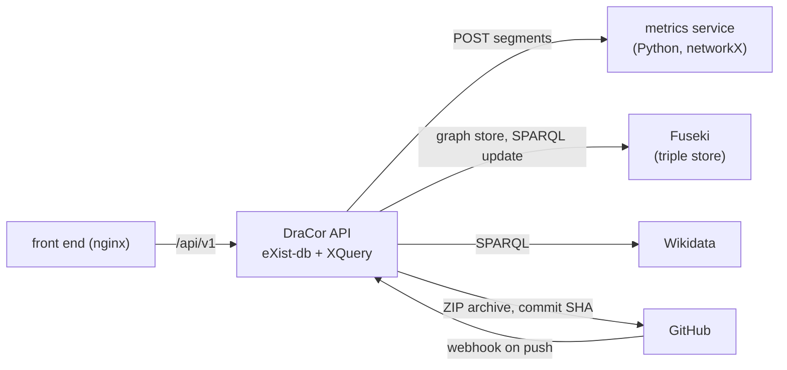

:::{note} Draft
:class: editorial
This page describes the DraCor API as of **dracor-api 1.5.0-rc.1** (release candidate, 31 October 2026); the current stable release on dracor.org is 1.4.1, and [staging.dracor.org](https://staging.dracor.org/api/v1/info) runs the development state after rc.1. It updates [D7.1 §5.3–5.5](#clsinfra-d71-5-3) and [D7.4 §3.2–3.4](#clsinfra-d74-3-2). All code links point to the exact lines in 1.5.0-rc.1.
:::

The DraCor API is the core of DraCor's Programmable Corpora: everything the website shows, and more, can be retrieved from it in JSON, CSV, TEI, plain text, RDF and network formats. Its design follows the domain of drama analysis, not the storage: the core entities are **corpora** and **plays**, and a play is broken down into its constituents (segments, characters, spoken text, stage directions) and the networks derived from them ([D7.1 §5.3](#clsinfra-d71-5-3)).

**Where to look up the endpoints.** The OpenAPI specification is the authoritative description of every endpoint, parameter and response: [interactive documentation](https://dracor.org/doc/api) (rendered with Scalar from front end 3.0 on; [Swagger UI](https://swagger.dracor.org) remains available) and the specification itself at [`/api/v1/openapi.yaml`](https://dracor.org/api/v1/openapi.yaml). This page does not repeat it; it describes how the API is built and how it works.

(dracor-api-architecture)=
## Architecture

The API is an [eXist-db](https://exist-db.org) application written in XQuery 3.1. Each endpoint is an XQuery function whose RESTXQ annotations declare the HTTP method, path and media types, as D7.1 described it ([§5.3.1](#clsinfra-d71-5-3-1)); since API 1.0 every path starts with `/v1`.

| | |
|---|---|
| Database | eXist-db 6.4.0 ([`Dockerfile`](https://github.com/dracor-org/dracor-api/blob/e93400b16e793b3600f4a91dca22790e9c12d868/Dockerfile#L30-L31)) on Java 17 |
| Package | `dracor-v1`, built as a XAR by [`build.sh`](https://github.com/dracor-org/dracor-api/blob/e93400b16e793b3600f4a91dca22790e9c12d868/build.sh#L26-L52) (version from `git describe`; replaced the ant build in 1.5.0-beta.1) |
| Deployment | Docker image `dracor/api` (published on every release); without Docker, [`deploy.sh`](https://github.com/dracor-org/dracor-api/blob/e93400b16e793b3600f4a91dca22790e9c12d868/deploy.sh#L1-L12) uploads the XAR to a running eXist-db. GitHub Actions deploy staging on every push to `main`, production on every release |
| Full stack | [`compose.yml`](https://github.com/dracor-org/dracor-api/blob/e93400b16e793b3600f4a91dca22790e9c12d868/compose.yml#L1-L24): API, Fuseki (triple store), metrics service, front end; the front end passes `/api/v1` to the API |
| Configuration | environment variables, written to `/db/dracor/config-v1.xml` on installation ([`post-install.xq`](https://github.com/dracor-org/dracor-api/blob/e93400b16e793b3600f4a91dca22790e9c12d868/post-install.xq#L51-L95)): `DRACOR_API_BASE`, `DRACOR_ID_BASE`, `FUSEKI_SERVER`, `METRICS_SERVER`; secrets (`FUSEKI_SECRET`, `GITHUB_WEBHOOK_SECRET`) go to a separate, protected file |



### Modules

| Module | Prefix | Content |
|---|---|---|
| [`api.xqm`](https://github.com/dracor-org/dracor-api/blob/e93400b16e793b3600f4a91dca22790e9c12d868/modules/api.xqm#L1-L1638) | `api` | all endpoints except DTS and the webhook (50 functions) |
| [`util.xqm`](https://github.com/dracor-org/dracor-api/blob/e93400b16e793b3600f4a91dca22790e9c12d868/modules/util.xqm#L1-L2440) | `dutil` | the logic behind the endpoints: play and corpus information, segments, text extraction, networks, creating corpora (79 functions) |
| [`dts.xqm`](https://github.com/dracor-org/dracor-api/blob/e93400b16e793b3600f4a91dca22790e9c12d868/modules/dts.xqm#L1-L1254) | `ddts` | Distributed Text Services 1.0 |
| [`metrics.xqm`](https://github.com/dracor-org/dracor-api/blob/e93400b16e793b3600f4a91dca22790e9c12d868/modules/metrics.xqm#L1-L211) | `metrics` | word counts, call to the metrics service, Wikipedia sitelinks |
| [`rdf.xqm`](https://github.com/dracor-org/dracor-api/blob/e93400b16e793b3600f4a91dca22790e9c12d868/modules/rdf.xqm#L1-L631) | `drdf` | RDF of each play and synchronisation with Fuseki |
| [`load.xqm`](https://github.com/dracor-org/dracor-api/blob/e93400b16e793b3600f4a91dca22790e9c12d868/modules/load.xqm#L1-L137) | `load` | loading a corpus from a ZIP archive |
| [`webhook.xqm`](https://github.com/dracor-org/dracor-api/blob/e93400b16e793b3600f4a91dca22790e9c12d868/modules/webhook.xqm#L1-L201) | `webhook` | GitHub webhook |
| [`trigger.xqm`](https://github.com/dracor-org/dracor-api/blob/e93400b16e793b3600f4a91dca22790e9c12d868/modules/trigger.xqm#L1-L57) | `dt` | database trigger: computes derived data when a play is stored or deleted |
| [`wikidata.xqm`](https://github.com/dracor-org/dracor-api/blob/e93400b16e793b3600f4a91dca22790e9c12d868/modules/wikidata.xqm#L1-L161), [`github.xqm`](https://github.com/dracor-org/dracor-api/blob/e93400b16e793b3600f4a91dca22790e9c12d868/modules/github.xqm#L1-L106), [`config.xqm`](https://github.com/dracor-org/dracor-api/blob/e93400b16e793b3600f4a91dca22790e9c12d868/modules/config.xqm#L1-L182) | `wd`, `gh`, `config` | Wikidata queries, GitHub URLs and commits, configuration |

The pattern D7.1 describes still holds: a small endpoint function in `api.xqm` declares the interface and calls functions in `util.xqm` that do the work. One example, the TEI of a play: [`api:play-tei`](https://github.com/dracor-org/dracor-api/blob/e93400b16e793b3600f4a91dca22790e9c12d868/modules/api.xqm#L810-L835) (compare D7.1 §5.3.1, where the same function had the path `/corpora/{corpusname}/play/{playname}/tei`).

(dracor-api-endpoints)=
## Endpoints

The 36 operations of the specification, grouped as in the interactive documentation. Details: [dracor.org/doc/api](https://dracor.org/doc/api).

| Group | Paths (after `/api/v1`) | Implemented in |
|---|---|---|
| API information | `/info` | [`api:info`](https://github.com/dracor-org/dracor-api/blob/e93400b16e793b3600f4a91dca22790e9c12d868/modules/api.xqm#L84-L143) |
| corpora | `/corpora`, `/corpora/{corpusname}`, `…/metadata`, `…/metadata/csv` | [`api:corpora`](https://github.com/dracor-org/dracor-api/blob/e93400b16e793b3600f4a91dca22790e9c12d868/modules/api.xqm#L238-L274), [`api:corpus-index`](https://github.com/dracor-org/dracor-api/blob/e93400b16e793b3600f4a91dca22790e9c12d868/modules/api.xqm#L431-L532), [`api:corpus-meta-data`](https://github.com/dracor-org/dracor-api/blob/e93400b16e793b3600f4a91dca22790e9c12d868/modules/api.xqm#L637-L657) |
| a play | `…/plays/{playname}`, `…/metrics`, `…/tei`, `…/txt` | [`api:play-info`](https://github.com/dracor-org/dracor-api/blob/e93400b16e793b3600f4a91dca22790e9c12d868/modules/api.xqm#L741-L760), [`api:play-metrics`](https://github.com/dracor-org/dracor-api/blob/e93400b16e793b3600f4a91dca22790e9c12d868/modules/api.xqm#L789-L808), [`api:play-tei`](https://github.com/dracor-org/dracor-api/blob/e93400b16e793b3600f4a91dca22790e9c12d868/modules/api.xqm#L810-L835), [`api:play-txt`](https://github.com/dracor-org/dracor-api/blob/e93400b16e793b3600f4a91dca22790e9c12d868/modules/api.xqm#L837-L855) |
| constituents of a play | `…/characters`, `…/characters/csv`, `…/spoken-text`, `…/spoken-text-by-character`, `…/stage-directions`, `…/stage-directions-with-speakers` | [`api:characters-info`](https://github.com/dracor-org/dracor-api/blob/e93400b16e793b3600f4a91dca22790e9c12d868/modules/api.xqm#L1237-L1256), [`api:spoken-text`](https://github.com/dracor-org/dracor-api/blob/e93400b16e793b3600f4a91dca22790e9c12d868/modules/api.xqm#L1314-L1378), [`api:stage-directions`](https://github.com/dracor-org/dracor-api/blob/e93400b16e793b3600f4a91dca22790e9c12d868/modules/api.xqm#L1510-L1530) and neighbours |
| networks | `…/networkdata/{csv,gexf,graphml}`, `…/relations/{csv,gexf,graphml}` | [`api:networkdata-csv`](https://github.com/dracor-org/dracor-api/blob/e93400b16e793b3600f4a91dca22790e9c12d868/modules/api.xqm#L964-L983), [`api:relations-csv`](https://github.com/dracor-org/dracor-api/blob/e93400b16e793b3600f4a91dca22790e9c12d868/modules/api.xqm#L1025-L1074) and neighbours |
| across corpora | `/id/{id}`, `/characters` (experimental), `/character/{id}` | [`api:id-to-url`](https://github.com/dracor-org/dracor-api/blob/e93400b16e793b3600f4a91dca22790e9c12d868/modules/api.xqm#L213-L236), [`api:plays-with-character`](https://github.com/dracor-org/dracor-api/blob/e93400b16e793b3600f4a91dca22790e9c12d868/modules/api.xqm#L1576-L1594) |
| Wikidata | `/wikidata/author/{id}`, `/wikidata/mixnmatch` | [`api:authorInfo`](https://github.com/dracor-org/dracor-api/blob/e93400b16e793b3600f4a91dca22790e9c12d868/modules/api.xqm#L1596-L1619), [`api:wikidata-mixnmatch`](https://github.com/dracor-org/dracor-api/blob/e93400b16e793b3600f4a91dca22790e9c12d868/modules/api.xqm#L1621-L1638) |
| DTS | `/dts`, `/dts/collection`, `/dts/navigation`, `/dts/document` | [`dts.xqm`](#dracor-api-dts) |
| admin | `POST /corpora`, `POST`/`DELETE /corpora/{corpusname}`, `PUT …/tei`, `DELETE …/plays/{playname}` | see [Loading data](#dracor-api-loading) |
| webhook | `POST /webhook/github` | [`webhook:github`](https://github.com/dracor-org/dracor-api/blob/e93400b16e793b3600f4a91dca22790e9c12d868/modules/webhook.xqm#L104-L201) |

Formats are chosen in two ways, as in D7.1: by the path (`…/networkdata/gexf`) or by the `Accept` header (`/id/{id}`, `…/spoken-text-by-character`, `…/metadata`).

A few routes are served but not part of the specification: `GET /v1/openapi.yaml` (the specification itself, with version and server URL filled in) and `GET /v1/openapi` (a second specification generated from the RESTXQ annotations), `GET /v1/resources` (a list of all routes), `…/word-frequencies/{elem}`, and [`…/plays/{playname}/rdf`](https://github.com/dracor-org/dracor-api/blob/e93400b16e793b3600f4a91dca22790e9c12d868/modules/api.xqm#L944-L962), the RDF of a play, to which `/id/{id}` redirects when RDF is requested.

(dracor-api-versions)=
## Versions

**Paths.** API 1.0.0 (December 2023) introduced the `/v1` prefix, plural `/plays/`, `characters` instead of `cast` and other renamings ([D7.4 §3.2](#clsinfra-d74-3-2)). The prefix is part of every RESTXQ path; the public URL `/api/v1` is mapped to it by the web server.

**The legacy API v0** is not part of this code: it lives on the branch `v0` of the repository (last release 0.91.3, January 2024) and runs as a separate package. The redirect from unversioned URLs (`/api/corpora`) is configured on the server, not in the API. Both will be shut down ([#15](https://github.com/dracor-org/dracor-tech-reports/issues/15)).

**Which version am I using?** `GET /info` returns the version of the API (taken from the release tag when the package is built), the eXist-db version, the base URL and the URL of the specification, and the time of the last change to the data (`lastModified`). For research, note the version and, for each corpus, the Git commit the API reports ([D7.3](#clsinfra-d73-index)).

| Release | Date | Main changes |
|---|---|---|
| 1.1.0 | July 2025 | DTS (draft version), Git commit of each corpus and play, `/txt`, new database layout, `x-dracor-feature` annotations in the specification, `sex` and `gender`, Wikipedia sitelinks |
| 1.1.1–1.1.6 | Aug.–Nov. 2025 | fixes; User-Agent for Wikidata requests |
| 1.2.0–1.2.3 | Feb.–March 2026 | two-letter language codes for titles; fixes |
| 1.3.0, 1.3.1 | April, May 2026 | Wikidata ID and dates of the digital source; `dracorCorpus` (replaces `teiCorpus`) |
| 1.4.0, 1.4.1 | July 2026 | editors, Wikidata IDs of characters, faster `/characters`, segmentation from `refsDecl/citeStructure` |
| 1.5.0-rc.1 | Oct. 2026 | **DTS 1.0**, Basic authentication declared in the specification, OpenAPI links, specification adapted to Scalar, Docker image runs under any user ID, Fuseki kept in sync on deletes, admin tests |

There is no changelog file; the notes are on the [releases page](https://github.com/dracor-org/dracor-api/releases).

(dracor-api-loading)=
## Loading data

Data gets into the API in three ways. All write operations require HTTP Basic authentication with an eXist-db user ([`local:is-authenticated`](https://github.com/dracor-org/dracor-api/blob/e93400b16e793b3600f4a91dca22790e9c12d868/modules/api.xqm#L284-L286)); the webhook is protected by a shared secret instead.

1. **A corpus from its repository.** `POST /corpora` with the corpus description (`corpus.xml`, or JSON with name, title and repository) creates an empty corpus (in rc.1 three functions, one per content type; after rc.1 merged into one, so that requests without an `Accept` header work). `POST /corpora/{corpusname}` then starts a background job ([`api:post-corpus`](https://github.com/dracor-org/dracor-api/blob/e93400b16e793b3600f4a91dca22790e9c12d868/modules/api.xqm#L534-L602), answer 202): [`load:load-corpus`](https://github.com/dracor-org/dracor-api/blob/e93400b16e793b3600f4a91dca22790e9c12d868/modules/load.xqm#L77-L130) asks GitHub for the latest commit, downloads that commit as a ZIP archive and stores `corpus.xml` and every file in `tei/`, together with the commit SHA. Running loads are listed in `/info` (`activeLoads`).
2. **A single play.** `PUT /corpora/{corpusname}/plays/{playname}/tei` adds or replaces one play ([`api:play-tei-put`](https://github.com/dracor-org/dracor-api/blob/e93400b16e793b3600f4a91dca22790e9c12d868/modules/api.xqm#L857-L918)). Because the data no longer matches a commit, the stored SHAs are removed.
3. **Automatically on every push**, where the corpus repository has a webhook for the server (as of November 2026 for staging and dev, not for production). The GitHub webhook ([`webhook:github`](https://github.com/dracor-org/dracor-api/blob/e93400b16e793b3600f4a91dca22790e9c12d868/modules/webhook.xqm#L104-L201)) checks the signature, the branch (`main`) and the repository, stores the delivery and schedules a job that fetches the changed files a minute later.

**What happens when a play is stored.** A database trigger ([`trigger.xqm`](https://github.com/dracor-org/dracor-api/blob/e93400b16e793b3600f4a91dca22790e9c12d868/modules/trigger.xqm#L13-L31), registered in [`data.xconf`](https://github.com/dracor-org/dracor-api/blob/e93400b16e793b3600f4a91dca22790e9c12d868/data.xconf#L13-L17)) computes the derived data and stores it in the play's collection next to the TEI, so that the endpoints can use precomputed values instead of computing them on every request:

| File | Content | Computed by |
|---|---|---|
| `tei.xml` | the play | (stored as received) |
| `metrics.xml` | word counts and network metrics ([details](#dracor-metrics-stored)) | [`metrics:update`](https://github.com/dracor-org/dracor-api/blob/e93400b16e793b3600f4a91dca22790e9c12d868/modules/metrics.xqm#L188-L201), which sends the segments and speakers to the metrics service |
| `sitelinks.xml` | number of Wikipedia articles on the play | [`metrics:update-sitelinks`](https://github.com/dracor-org/dracor-api/blob/e93400b16e793b3600f4a91dca22790e9c12d868/modules/metrics.xqm#L42-L55) (Wikidata) |
| `rdf.xml` | the play as RDF; also sent to Fuseki | [`drdf:update-play`](https://github.com/dracor-org/dracor-api/blob/e93400b16e793b3600f4a91dca22790e9c12d868/modules/rdf.xqm#L466-L482) |
| `git.xml` | commit SHA of this version of the play | the loader |

The segments (scenes) that the network is computed from are taken from the play's `refsDecl/citeStructure` or the corpus description, if present (since 1.4.0), and otherwise determined from the TEI structure ([`dutil:get-segments`](https://github.com/dracor-org/dracor-api/blob/e93400b16e793b3600f4a91dca22790e9c12d868/modules/util.xqm#L461-L495)).

(dracor-api-values)=
## The values the API computes

Most of what the API returns is taken from the TEI as it is (titles, authors, years, characters). Some values, however, are computed by the API itself: counts, word counts, a few derived values, and the corpus metrics. The network metrics come from the [metrics service](#dracor-metrics-values) and are listed there. The table gives, for each computed value, how it is computed, where in the code, where the API returns it, and its feature name in the specification (`x-dracor-feature`) and in D7.1 (Tab. 01, 02, 04).

**Corpus** (`/corpora?include=metrics`, schema `CorpusMetrics`; computed on each request by [`dutil:get-corpus-metrics`](https://github.com/dracor-org/dracor-api/blob/e93400b16e793b3600f4a91dca22790e9c12d868/modules/util.xqm#L801-L834))

| API field | How it is computed | Feature | D7.1 |
|---|---|---|---|
| `plays` | number of TEI documents in the corpus | `corpus_num_of_plays` | C9 |
| `characters` | number of `person` and `personGrp` in the `listPerson`s of all plays (speaking or not) | `corpus_num_of_characters` | C10 |
| `male`, `female` | the same, with `@sex="MALE"` or `"FEMALE"` | `corpus_num_of_characters_male`, `…_female` | C11, C12 |
| `text` | number of `tei:text` elements | `corpus_num_of_tei_text_elements` | C13 |
| `sp`, `stage` | number of speeches and stage directions | `corpus_num_of_sp`, `corpus_num_of_stage` | C14, C15 |
| `wordcount.text`, `.sp`, `.stage` | sums of the word counts of the plays (below) | `corpus_num_of_word_tokens_in_text_elements`, `…_in_sp`, `…_in_stage` | C16–C18 |
| `updated` | latest calculation date of the plays' `metrics.xml` | `corpus_metrics_date_updated` | C19 |

**Play** (`/corpora/{corpusname}/metadata` and `…/csv`, schema `PlayMetadata`, [`dutil:get-corpus-meta-data`](https://github.com/dracor-org/dracor-api/blob/e93400b16e793b3600f4a91dca22790e9c12d868/modules/util.xqm#L866-L1003); some also in `/plays/{playname}`)

| API field | How it is computed | Code | Feature | D7.1 |
|---|---|---|---|---|
| `wordCountText`, `wordCountSp`, `wordCountStage` | words (split at non-word characters) in the `text`, in all `sp` and in all `stage` elements; computed when the play is stored and kept in [`metrics.xml`](#dracor-metrics-stored) | [`metrics:calculate`](https://github.com/dracor-org/dracor-api/blob/e93400b16e793b3600f4a91dca22790e9c12d868/modules/metrics.xqm#L167-L186) | `play_num_of_word_tokens_in_text_elements`, `…_in_sp`, `…_in_stage` | P41–P43 |
| `numOfSegments` | number of segments (scenes, or the units of `refsDecl/citeStructure`) | [L968](https://github.com/dracor-org/dracor-api/blob/e93400b16e793b3600f4a91dca22790e9c12d868/modules/util.xqm#L968) | `play_num_of_segments` | P37 |
| `numOfActs`, `numOfScenes` | number of `div[@type="act"]` and `div[@type="scene"]` in the body | [L969–970](https://github.com/dracor-org/dracor-api/blob/e93400b16e793b3600f4a91dca22790e9c12d868/modules/util.xqm#L969-L970) | `play_num_of_acts`; `numOfScenes` has none | P38 |
| `numOfSpeakers` | number of different IDs in `sp/@who` | [L886](https://github.com/dracor-org/dracor-api/blob/e93400b16e793b3600f4a91dca22790e9c12d868/modules/util.xqm#L886) | `play_num_of_speakers` | P45 |
| `numOfSpeakersMale`, `…Female`, `…Unknown` | number of characters in the `listPerson` with that `@sex`, **including characters who do not speak** | [L887–894](https://github.com/dracor-org/dracor-api/blob/e93400b16e793b3600f4a91dca22790e9c12d868/modules/util.xqm#L887-L894) | `play_num_of_speakers_sex_male`, `…_female`, `…_unknown` | P46–P48 (`…_gender_…`) |
| `numOfPersonGroups` | number of `personGrp` | [L895](https://github.com/dracor-org/dracor-api/blob/e93400b16e793b3600f4a91dca22790e9c12d868/modules/util.xqm#L895) | `play_num_of_person_groups` | P49 |
| `numOfP`, `numOfL` | prose paragraphs and verse lines in speeches; a verse split between speakers (`@part`) counts once | [L896–900](https://github.com/dracor-org/dracor-api/blob/e93400b16e793b3600f4a91dca22790e9c12d868/modules/util.xqm#L896-L900) | `play_num_of_paragraphs`, `play_num_of_verse_lines` | P39, P40 |
| `numOfCoAuthors` | number of authors minus one | [L958–962](https://github.com/dracor-org/dracor-api/blob/e93400b16e793b3600f4a91dca22790e9c12d868/modules/util.xqm#L958-L962) | `play_num_of_co_authors` | P21 |
| `wikipediaLinkCount` | number of Wikipedia articles on the play, from Wikidata; fetched when the play is stored and kept in `sitelinks.xml` | [`dutil:count-sitelinks`](https://github.com/dracor-org/dracor-api/blob/e93400b16e793b3600f4a91dca22790e9c12d868/modules/util.xqm#L668-L682), [`metrics:update-sitelinks`](https://github.com/dracor-org/dracor-api/blob/e93400b16e793b3600f4a91dca22790e9c12d868/modules/metrics.xqm#L42-L55) | `play_num_of_wikipedia_links` | P35 |
| `yearNormalized` | one year per play: the earlier of premiere and print year; but the year of writing if that is more than ten years earlier (see the [FAQ](https://dracor.org/doc/faq#normalized-year)) | [`dutil:get-normalized-year`](https://github.com/dracor-org/dracor-api/blob/e93400b16e793b3600f4a91dca22790e9c12d868/modules/util.xqm#L630-L666) | `play_year_normalized` | P27 |
| `normalizedGenre`, `libretto` | the first `textClass` keyword that is not "Libretto"; `libretto` is true if one of them is | [`dutil:get-genre`](https://github.com/dracor-org/dracor-api/blob/e93400b16e793b3600f4a91dca22790e9c12d868/modules/util.xqm#L852-L864), [L949–950](https://github.com/dracor-org/dracor-api/blob/e93400b16e793b3600f4a91dca22790e9c12d868/modules/util.xqm#L949-L950) | `play_genre_normalized`, `play_is_libretto` | P22, P23 |
| `allInSegment`, `allInIndex` (only in `/plays/{playname}`) | the first segment in which the last character to enter speaks, and that number divided by the number of segments: how late in the play all characters have appeared | [`dutil:get-play-info`](https://github.com/dracor-org/dracor-api/blob/e93400b16e793b3600f4a91dca22790e9c12d868/modules/util.xqm#L1467-L1468) | `play_all_in_segment`, `play_all_in_index` | P50, P51 |

**Character** (`…/plays/{playname}/characters` and `…/csv`, schema `Character`, [`dutil:characters-info`](https://github.com/dracor-org/dracor-api/blob/e93400b16e793b3600f4a91dca22790e9c12d868/modules/util.xqm#L1683-L1726))

| API field | How it is computed | Feature | D7.1 |
|---|---|---|---|
| `numOfScenes` | number of segments in which the character speaks | `character_num_of_segments` | Ch11 |
| `numOfSpeechActs` | number of speeches by the character alone (speeches with several speakers in `@who` are not counted) | `character_num_of_sp` | Ch12 |
| `numOfWords` | words in the character's speeches, without stage directions and notes; counts `w` elements if the play has them; words of joint speeches count for every speaker | `character_num_of_word_tokens` | Ch13 |

**API status** (`/info`): `lastModified` is the time of the latest change in the corpora ([L97–105](https://github.com/dracor-org/dracor-api/blob/e93400b16e793b3600f4a91dca22790e9c12d868/modules/api.xqm#L97-L105)), `activeLoads` lists running corpus loads ([L108–115](https://github.com/dracor-org/dracor-api/blob/e93400b16e793b3600f4a91dca22790e9c12d868/modules/api.xqm#L108-L115)); features `service_last_modified`, `service_active_loads`.

### Details that matter when comparing values

- **Word counts are counted in two ways.** The play's `wordCountSp` counts everything inside `sp`, including speaker labels and stage directions within speeches; a character's `numOfWords` excludes both. The sum of the characters' `numOfWords` is therefore not the play's `wordCountSp`.
- **Speakers by sex** count characters in the cast list, not speakers: a character who never speaks is included in `numOfSpeakersMale`, but not in `numOfSpeakers`.
- **`maxDegreeIds` in the corpus metadata** is a string: up to three IDs joined with `|`, and "several characters" if four or more characters share the highest degree. In `…/metrics` it is a list.
- **Corpus metrics are computed on each request**, the play values partly when a play is stored (word counts, Wikipedia links, network metrics) and partly on each request (all other counts).

(dracor-api-services)=
## Services used by the API

- **Metrics service** ([dracor-metrics](https://github.com/dracor-org/dracor-metrics), 1.6.0 in the compose file): a separate Python service with one endpoint that computes the network metrics with networkX from the segments and speakers it is sent, as described in [D7.1 §5.4](#clsinfra-d71-5-4). It is called only when a play is stored, not on requests.
- **Fuseki** (triple store, [D7.1 §5.5](#clsinfra-d71-5-5)): receives the RDF of every play; since 1.5.0-rc.1 its graphs are also removed when a play or corpus is deleted.
- **Wikidata**: sitelinks when a play is stored; author information for the front end (`/wikidata/author/{id}`); the Mix'n'match catalogue of DraCor IDs ([D7.4 §3.2](#clsinfra-d74-3-2)).
- **GitHub**: commit SHAs and ZIP archives when loading; webhook deliveries on push.

(dracor-api-dts)=
## DTS

The API implements the [Distributed Text Services](https://dtsapi.org/specifications/versions/v1.0/) in the module [`dts.xqm`](https://github.com/dracor-org/dracor-api/blob/e93400b16e793b3600f4a91dca22790e9c12d868/modules/dts.xqm#L1-L30). [D7.4 §3.4](#clsinfra-d74-3-4) describes a draft version of the specification (between "1-alpha" and 1.0); since 1.5.0-beta.1 the API follows **DTS 1.0**, checked with the official DTS validator.

- **Collections and resources:** the root collection is DraCor, its members are the corpora, their members the plays.
- **Citation tree:** `front`, `body`, `back`; below them the nested `div`s (usually acts and scenes; their `@type` becomes the cite type); below those the speeches, stage directions, settings, cast list and title page. References are path-like (`body/div[2]/sp[3]`); `@xml:id`s are accepted as well. The tree is derived from the TEI structure of each play (not from `refsDecl/citeStructure`, which is used only for the network segments).
- **Formats:** TEI and plain text.

A worked example is the DTS notebook in the [DraCor Notebooks](https://github.com/dracor-org/dracor-notebooks/blob/1c922c1d0804329cc3e9c87a51d9b40b1e5bccc3/dts/dts.ipynb): it demonstrates the Collection, Navigation and Document endpoints and compares DTS with the regular DraCor API. Since November 2026 it targets DTS 1.0 (API 1.5; until 1.5 is released it runs against the staging server); its [README](https://github.com/dracor-org/dracor-notebooks/blob/1c922c1d0804329cc3e9c87a51d9b40b1e5bccc3/dts/README.md) lists the changes from DTS "unstable". The earlier version, the executable form of D7.4 §3.4, is archived under the tag `2026-11-15-baseline` ([doi:10.5281/zenodo.24237155](https://hdl.handle.net/10.5281/zenodo.24237155)).

(dracor-api-fundocs)=
## Function documentation in eXist-db

The XQuery functions are documented in the code: each has a comment in xqDoc format (`(:~ … :)`, with `@param` and `@return`) above its declaration, as in the example in [D7.1 §5.3.1](#clsinfra-d71-5-3-1). eXist-db can render these comments as browsable documentation with its app **XQuery Function Documentation** ("fundocs"), which is installed in the DraCor Docker image (fundocs 1.2.1). eXist-db's own web interface is not reachable on dracor.org, so this works on a local instance (or on your own, see [Deployment](#spinoffs-deploy)).

1. **Start the API locally**, e.g. from the official image, reachable only from your own machine:

   ```sh
   docker run --rm -p 127.0.0.1:8080:8080 -e EXIST_PASSWORD= dracor/api:1.5.0-rc.1
   ```

   The empty admin password is accepted only because the image runs in development mode by default; never use it on a server. With the repository, `docker compose up` does the same (see [Architecture](#dracor-api-architecture)).
2. **Log in as `admin`** in eXist-db's dashboard: <http://localhost:8080/exist/apps/dashboard/>. Only members of the `dba` group may generate the documentation.
3. **Generate the documentation:** open <http://localhost:8080/exist/apps/fundocs/> and click **Generate** (after installing a new version of the API: **Regenerate**). This scans all XQuery modules in the database, including the DraCor modules in `/db/apps/dracor-v1/modules/`, and takes a few seconds. Without a browser: `curl -u admin: http://localhost:8080/exist/apps/fundocs/modules/reindex.xql`.
4. **Find a function:** search by name (e.g. `play-tei`), signature or description. Or open the page of a module directly; for the endpoint module:

   <http://localhost:8080/exist/apps/fundocs/view.html?uri=http://dracor.org/ns/exist/v1/api&location=/db/apps/dracor-v1/modules/api.xqm&details=true>

   For the other modules, replace `api` in both places with the module name (`util`, `dts`, `metrics`, `rdf`, `load`, `webhook`, `wikidata`, `github`, `config`); the namespace of every module is `http://dracor.org/ns/exist/v1/<module>`.

The documentation contains the public functions of each module (tested with 1.5.0-rc.1: 47 in `api`, 61 in `util`, 1 to 7 in the smaller modules); private helper functions are left out. The DraCor modules do not appear in the "Browse" list of this fundocs version, but the search and the module pages find them. The same information is available as XML from any XQuery, e.g. in eXide: `inspect:inspect-module(xs:anyURI("/db/apps/dracor-v1/modules/api.xqm"))`, which is the function fundocs itself uses.

(dracor-api-docs)=
## Specification and tests

**The specification is written by hand** ([`api.yaml`](https://github.com/dracor-org/dracor-api/blob/e93400b16e793b3600f4a91dca22790e9c12d868/api.yaml#L1-L3191), OpenAPI 3.1) and checked with Redocly lint. It contains response schemas for all endpoints (since 1.0.0) and, on 184 schema properties, an `x-dracor-feature` annotation that names the feature the value represents (117 distinct features). These are the "features" of [D7.4 §3.3](#clsinfra-d74-3-3), which D7.4 proposed as the link between the TEI encoding (ODD), the code and the API documentation; they are now in the specification. When served, the version number and server URL in the file are replaced by those of the running instance.

**Tests run against a running API** (Docker, with a test corpus), on every push and pull request:

| Test | What it checks |
|---|---|
| [Schemathesis](https://schemathesis.io) | requests generated from the specification; checks responses against the schemas |
| DTS validator + contract tests | the four DTS endpoints against DTS 1.0 |
| admin tests | creating, loading and deleting corpora and plays |

(dracor-api-reports)=
## From the reports to this page

| Report | Topic | Now |
|---|---|---|
| D7.1 §5.3 intro, §5.3.1 | design, RESTXQ, `api.xqm` | [Architecture](#dracor-api-architecture) (pattern unchanged; paths with `/v1`) |
| D7.1 §5.3.2 | OpenAPI, Swagger UI | [Specification](#dracor-api-docs); Scalar from front end 3.0 |
| D7.1 §5.3.3 | endpoint groups, `/info`, `/id` | [Endpoints](#dracor-api-endpoints), [Versions](#dracor-api-versions) |
| D7.1 Tab. 01–05 | features of corpora, plays, characters; network metrics | still valid as a description of the data; the feature names are now in the specification (`x-dracor-feature`) |
| D7.1 §5.3.4 | API wrappers | pydracor, rdracor (to be documented separately) |
| D7.1 §5.4, §5.5 | metrics service, SPARQL | [Services](#dracor-api-services) |
| D7.4 §3.2 | API 1.0, renamings, Wikidata endpoints | [Versions](#dracor-api-versions), [Services](#dracor-api-services) |
| D7.4 §3.3 | features, ontology, OpenAPI | [Specification](#dracor-api-docs) |
| D7.4 §3.4 | DTS (draft version) | [DTS](#dracor-api-dts) (DTS 1.0) |
