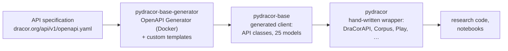

:::{note} Draft
:class: editorial
This page describes the API libraries as of November 2026: **pydracor 3.0.2** with **pydracor-base 1.0.1**, and **rdracor 1.1.0**. It updates [D7.1 §5.3.4](#clsinfra-d71-5-3-4) and [D7.2](#clsinfra-d72-index), which describe pydracor 1.0.0 and rdracor 0.7.2. Code links point to the exact lines.
:::

The [DraCor API](#dracor-api) can be used from any programming language. For the two languages most used in Computational Literary Studies, libraries ("API wrappers") turn the API's endpoints into functions and objects, so that researchers can work with corpora, plays and characters without writing HTTP requests ([D7.2](#clsinfra-d72-index)).

| | pydracor | rdracor |
|---|---|---|
| Language | Python | R |
| Package | [PyPI: pydracor](https://pypi.org/project/pydracor/) 3.0.2 (Sept. 2025) | [CRAN: rdracor](https://cran.r-project.org/package=rdracor) 1.1.0 (Oct. 2026) |
| Repository | [dracor-org/pydracor](https://github.com/dracor-org/pydracor) | [dracor-org/rdracor](https://github.com/dracor-org/rdracor) |
| How it is built | a hand-written layer on a package **generated** from the API specification ([below](#docs-libraries-pydracor-build)) | written by hand |
| API | v1; the generated part follows the specification of API 1.1.4 | v1 (since 1.0.3, April 2024) |
| Default server | `https://dracor.org/api/v1`; another server can be set (`host`) | `https://dracor.org/api/v1`; `set_dracor_api_url()` |
| Authors | Henny Sluyter-Gäthje, Eduard Grigoriev (maintainer: Henny Sluyter-Gäthje) | Ivan Pozdniakov |
| Licence | MIT | GPL (≥ 3) |
| Citation | [doi:10.5281/zenodo.24334023](https://hdl.handle.net/10.5281/zenodo.24334023) (concept DOI, all versions) | `citation("rdracor")` |

A Haskell package ([hdracor](https://github.com/dracor-org/hdracor)) exists as well but has not been updated since 2021.

(docs-libraries-pydracor)=
## pydracor

(docs-libraries-pydracor-build)=
### How pydracor is built

Since version 3.0 (September 2025), pydracor consists of two packages. The lower one is not written by hand but generated from the [OpenAPI specification](#dracor-api-docs) of the API:

1. **[pydracor-base-generator](https://github.com/dracor-org/pydracor-base-generator)** contains the command that generates the client and 42 custom templates. The command ([`openapi-docker.sh`](https://github.com/dracor-org/pydracor-base-generator/blob/b3a183f8190803922c8399f4279432b4bfe36723/openapi-docker.sh#L1-L11)) runs the [OpenAPI Generator](https://openapi-generator.tech) in Docker with the Python generator, the templates and the package name and version (`pydracor_base`, 1.0.1). The templates set authors and repository in the generated files and work around a limitation of the generated code, which cannot deserialise responses of type `application/xml` (e.g. the TEI).
2. **[pydracor-base](https://github.com/dracor-org/pydracor-base)** is the generated code: one class per tag of the specification (`PublicApi`, `AdminApi`, `DTSApi`, `WikidataApi`, `WebhookApi`) with one method per endpoint, and one model class (pydantic) per schema of the specification. The current version, 1.0.1 ([PyPI](https://pypi.org/project/pydracor-base/), September 2025), was generated from the specification of API 1.1.4 with OpenAPI Generator 7.11.0.
3. **[pydracor](https://github.com/dracor-org/pydracor)** wraps the generated client in a few classes that are easier to use ([`api_wrapper.py`](https://github.com/dracor-org/pydracor/blob/de28a6bd49cd03670f0fdc24d35b7c376295974e/src/pydracor/api_wrapper.py#L1-L506)). It depends on exactly one version of the base (`pydracor-base==1.0.1`, [`pyproject.toml`](https://github.com/dracor-org/pydracor/blob/de28a6bd49cd03670f0fdc24d35b7c376295974e/pyproject.toml#L41-L43)).

| Class | Methods (selection) | API |
|---|---|---|
| [`DraCorAPI`](https://github.com/dracor-org/pydracor/blob/de28a6bd49cd03670f0fdc24d35b7c376295974e/src/pydracor/api_wrapper.py#L69-L159) | `get_info`, `get_corpora`, `get_corpus`, `get_play`, `get_plays_with_character_by_id` | `/info`, `/corpora`, `/character/{id}` |
| [`Corpus`](https://github.com/dracor-org/pydracor/blob/de28a6bd49cd03670f0fdc24d35b7c376295974e/src/pydracor/api_wrapper.py#L161-L208) | `get_metadata`, `get_metadata_csv`, `get_play` | `/corpora/{corpusname}`, `…/metadata` |
| [`Play`](https://github.com/dracor-org/pydracor/blob/de28a6bd49cd03670f0fdc24d35b7c376295974e/src/pydracor/api_wrapper.py#L210-L355) | `get_metrics`, `get_tei`, `get_txt`, `get_characters`, `get_networkdata`, `get_relations`, `get_spoken_text` (with filters by sex, role, relation), `get_stage_directions` | `…/plays/{playname}/…` |
| [`Wikidata`](https://github.com/dracor-org/pydracor/blob/de28a6bd49cd03670f0fdc24d35b7c376295974e/src/pydracor/api_wrapper.py#L357-L392) | `get_author_info`, `get_mixnmatch` | `/wikidata/…` |
| [`DTS`](https://github.com/dracor-org/pydracor/blob/de28a6bd49cd03670f0fdc24d35b7c376295974e/src/pydracor/api_wrapper.py#L394-L506) | `get_collection`, `get_navigation`, `get_document` | `/dts/…` |

`Corpus` and `Play` are subclasses of the generated models, so all fields of the API responses are available as attributes. The tests run on every push to `main` and every pull request against a DraCor instance started with Docker (API 1.1.0; [`ci.yml`](https://github.com/dracor-org/pydracor/blob/de28a6bd49cd03670f0fdc24d35b7c376295974e/.github/workflows/ci.yml#L1-L56)).

### What this means for maintenance

The generated base reflects the API specification at the time it was generated, API 1.1.4. Changes in later API versions reach pydracor only when the base is generated again and pydracor is adapted to it; this concerns in particular DTS 1.0 in API 1.5 (the base was generated for the earlier draft version of DTS) and fields added later, such as the editors of a play and the Wikidata IDs of characters (API 1.4.0). Three points would make this reproducible:

- the generator reads the specification from the production server, so the result depends on the day it is run; reading it from a release of the API (e.g. `api.yaml` at a tag) would tie each base version to an API version;
- the package version is set in the command by hand;
- neither pydracor-base nor the generator has tags or releases, and pydracor-base has no licence file.

(docs-libraries-pydracor-history)=
### Versions

| Version | Date | |
|---|---|---|
| 1.0.0 | Feb. 2023 | described in D7.2; uses the unversioned legacy API (`dracor.org/api/…`) |
| 2.0.0 | Dec. 2023 | adapted to API 1.0 (`/api/v1`) |
| 3.0.0–3.0.2 | Sept. 2025 | rebuilt on the generated pydracor-base; classes `DraCorAPI`, `Corpus`, `Play`, `Wikidata`, `DTS` |

Code written for pydracor 1.x or 2.x does not run with 3.x: the classes and method names changed, and the `filter` method of 1.0.0 for building subcorpora (D7.2, Tab. 02) no longer exists. Older code should pin the version it was written for (`pip install pydracor==2.0.0`); the [DraCor Notebooks](https://github.com/dracor-org/dracor-notebooks) record the tested versions for each notebook. Since version 3.0.2, releases are archived on Zenodo.

(docs-libraries-rdracor)=
## rdracor

rdracor is written by hand and published on CRAN. Its 29 functions ([`NAMESPACE`](https://github.com/dracor-org/rdracor/blob/5ca03ec94628c53d5ff63741cd89cfdc4201f997/NAMESPACE#L1-L74)) return data frames (tibbles), igraph objects or parsed XML:

| Group | Functions |
|---|---|
| API and connection | `dracor_api`, `dracor_api_info`, `dracor_api_available`, `get_dracor_api_url`, `set_dracor_api_url`, `dracor_sparql` |
| corpora | `get_dracor`, `get_dracor_meta` |
| plays | `get_play_metadata`, `get_play_characters`, `get_play_rdf`, `get_character_plays` |
| texts | `get_text_tei`, `get_text_df`, `tei_to_df`, `get_text_chr_spoken`, `get_text_chr_spoken_bych`, `get_text_chr_stage`, `get_text_chr_stage_with_sp` |
| networks | `get_net_cooccur_edges`, `…_igraph`, `…_gexf`, `…_graphml`, `…_metrics`; `get_net_relations_edges`, `…_igraph`, `…_gexf`, `…_graphml`; `label_cooccur_igraph` and `plot()` methods |

Beyond the API endpoints, rdracor turns the TEI of a play into a table of speeches and stage directions (`tei_to_df`, `get_text_df`), builds networks as igraph objects for analysis in R, and queries the SPARQL endpoint. `get_play_rdf` uses the route `…/plays/{playname}/rdf`, which the API serves but does not list in its specification ([API › Endpoints](#dracor-api-endpoints)).

**Version 1.1.0** (October 2026; [NEWS](https://github.com/dracor-org/rdracor/blob/5ca03ec94628c53d5ff63741cd89cfdc4201f997/NEWS.md#L1-L45)): all functions fail gracefully if the API is not reachable (a message and `NULL` instead of an error); time limits for requests; `dracor_api_available()`; fixes for verse lines in `<lg>`, for the plot functions and for the renaming of `gender` to `sex` in API 1.1.0. History on CRAN: 0.7.2 (January 2023, described in D7.2), 0.7.6, 1.0.3 (April 2024, API v1), 1.0.4–1.0.6, 1.1.0.

(docs-libraries-reports)=
## From the reports to this page

| Report | Topic | Now |
|---|---|---|
| D7.1 §5.3.4 | API wrappers in general | this page |
| D7.2 §2.1 | rdracor 0.7.2: CRAN page, functions (Tab. 01) | [rdracor](#docs-libraries-rdracor): 1.1.0, same purpose, more functions, API v1 |
| D7.2 §2.2 | pydracor 1.0.0: PyPI page, functions (Tab. 02) | [pydracor](#docs-libraries-pydracor): rebuilt in 3.0 on a generated client; new classes, no `filter` |
| D7.2 appendices | reference manuals of rdracor 0.7.2 and pydracor 1.0.0 | current reference: [rdracor on CRAN](https://cran.r-project.org/package=rdracor), [pydracor README](https://github.com/dracor-org/pydracor#readme) |
