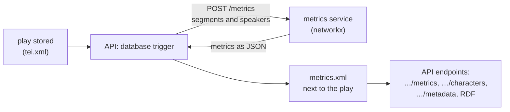

:::{note} Draft
:class: editorial
This page describes **dracor-metrics 1.6.0** (30 October 2026, networkx 3.7), the version in the compose file of [dracor-api 1.5.0-rc.1](#dracor-api). It updates [D7.1 §5.4](#clsinfra-d71-5-4), which describes version 1.2.0. All code links point to the exact lines.
:::

The network metrics that DraCor offers for every play (density, diameter, centralities of the characters, …) are not computed by the API itself but by a small, separate service written in Python: [dracor-metrics](https://github.com/dracor-org/dracor-metrics). It has a single task: it receives the segments of a play with their speakers, builds the co-presence network with [networkx](https://networkx.org) and returns its metrics.

(dracor-metrics-system)=
## Place in the system



1. When a play is stored, the API's database trigger calls [`metrics:update`](https://github.com/dracor-org/dracor-api/blob/e93400b16e793b3600f4a91dca22790e9c12d868/modules/metrics.xqm#L188-L201) (see [API › Loading data](#dracor-api-loading)).
2. [`metrics:get-network-metrics`](https://github.com/dracor-org/dracor-api/blob/e93400b16e793b3600f4a91dca22790e9c12d868/modules/metrics.xqm#L88-L165) takes the segments of the play ([`dutil:get-segments`](https://github.com/dracor-org/dracor-api/blob/e93400b16e793b3600f4a91dca22790e9c12d868/modules/util.xqm#L461-L495): scenes, or the units defined in `refsDecl/citeStructure`) and, for each segment, the IDs of the characters who speak in it ([`dutil:distinct-speakers`](https://github.com/dracor-org/dracor-api/blob/e93400b16e793b3600f4a91dca22790e9c12d868/modules/util.xqm#L157-L169): every ID in `sp/@who`), and posts them to the service. A play without any `sp/@who` gets size 0 without a call.
3. The answer is stored in the play's `metrics.xml` ([see below](#dracor-metrics-stored)), together with the word counts that the API computes itself. If the service fails, the play gets no network metrics; the failure is only logged.
4. API requests that return network metrics (e.g. `…/metrics`, `…/characters`, the corpus metadata) are based on the values stored in `metrics.xml`; the metrics service itself is only called when a play is stored. The service is not reachable from outside.

(dracor-metrics-stored)=
### Where the values are stored: `metrics.xml`

`metrics.xml` is a small XML file that exists for every play in the API's database (eXist-db) once its metrics have been calculated, i.e. after the play was stored and the metrics service was called. It is not part of the corpus repository on GitHub. Each play has a collection in the database that holds its TEI and the data derived from it, e.g. for *Emilia Galotti*:

```
/db/dracor/corpora/ger/lessing-emilia-galotti/
    tei.xml         the play, as loaded from the corpus repository
    metrics.xml     word counts and network metrics
    rdf.xml         the play as RDF
    git.xml         commit SHA of this version of the play
    sitelinks.xml   number of Wikipedia articles on the play
```

`metrics.xml` is written by [`metrics:calculate`](https://github.com/dracor-org/dracor-api/blob/e93400b16e793b3600f4a91dca22790e9c12d868/modules/metrics.xqm#L167-L186). It contains the word counts computed by the API (`text`, `stage`, `sp`) and, under `network`, the answer of the metrics service, one element per value and one `node` element per character:

```xml
<metrics updated="…">
  <text>…</text> <stage>…</stage> <sp>…</sp>
  <network>
    <size>13</size> <density>…</density> <diameter>3</diameter> …
    <maxDegreeIds>marinelli</maxDegreeIds>
    <nodes>
      <node id="marinelli"><degree>9</degree> <betweenness>…</betweenness> …</node>
    </nodes>
  </network>
</metrics>
```

The file itself is not available through the API; its values reach users through the endpoints listed [below](#dracor-metrics-values).

(dracor-metrics-interface)=
## Interface

| Request | Answer |
|---|---|
| `GET /` | name and version of the service: `{"service": "dracor-metrics", "version": "1.6.0"}` |
| `POST /metrics` | the metrics of one play (below) |

The request body lists the segments with their speakers, as in D7.1:

```json
{"segments": [{"speakers": ["speaker_1", "speaker_2"]}, {"speakers": ["speaker_1", "speaker_3"]}]}
```

The answer contains the metrics of the network and, under `nodes`, those of each character ([`app/models.py`](https://github.com/dracor-org/dracor-metrics/blob/c79cc6e184ae8f507b794476b4cafd5ff1f9dea3/app/models.py#L17-L38)). For the example above, metrics 1.6.0 returns exactly the values printed in D7.1 §5.4, which were computed with metrics 1.2.0 and networkx 2.5 (checked 22 November 2026). The service is built with FastAPI, which also generates an OpenAPI description of it (`/openapi.json`, `/docs`).

(dracor-metrics-network)=
## How the network is built

The code is in one function ([`app/main.py`](https://github.com/dracor-org/dracor-metrics/blob/c79cc6e184ae8f507b794476b4cafd5ff1f9dea3/app/main.py#L20-L86)). The graph ([lines 24–42](https://github.com/dracor-org/dracor-metrics/blob/c79cc6e184ae8f507b794476b4cafd5ff1f9dea3/app/main.py#L24-L42)) is an undirected `networkx.Graph`:

- **Nodes** are the characters who speak in at least one segment. A character who is the only speaker of a segment is added as a node even if they never share a segment with anyone.
- **Edges** connect every pair of characters who speak in the same segment ("co-presence").
- **Weight** of an edge: the number of segments in which the two characters both speak.

Only the weighted degree uses the weights; all other metrics are computed on the unweighted graph.

(dracor-metrics-values)=
## The metrics and where the API shows them

| Value | How it is computed (1.6.0) | networkx 3.7 | API field | Feature (`x-dracor-feature`) | D7.1 |
|---|---|---|---|---|---|
| `size` | number of nodes ([L44](https://github.com/dracor-org/dracor-metrics/blob/c79cc6e184ae8f507b794476b4cafd5ff1f9dea3/app/main.py#L44)) | | `size`; `networkSize` in the corpus list | `play_network_size` | P55 |
| `numEdges` | number of edges ([L84](https://github.com/dracor-org/dracor-metrics/blob/c79cc6e184ae8f507b794476b4cafd5ff1f9dea3/app/main.py#L84)) | `Graph.number_of_edges` | `numEdges` | `play_network_num_edges` | P56 |
| `averageDegree` | sum of the degrees divided by the number of nodes ([L79](https://github.com/dracor-org/dracor-metrics/blob/c79cc6e184ae8f507b794476b4cafd5ff1f9dea3/app/main.py#L79)) | | `averageDegree` | `play_network_average_degree` | P57 |
| `density` | edges divided by possible edges ([L76](https://github.com/dracor-org/dracor-metrics/blob/c79cc6e184ae8f507b794476b4cafd5ff1f9dea3/app/main.py#L76)) | [`density`](https://networkx.org/documentation/networkx-3.7/reference/generated/networkx.classes.function.density.html) | `density` | `play_network_density` | P58 |
| `diameter` | longest of all shortest paths between connected pairs ([L48](https://github.com/dracor-org/dracor-metrics/blob/c79cc6e184ae8f507b794476b4cafd5ff1f9dea3/app/main.py#L48), [L77](https://github.com/dracor-org/dracor-metrics/blob/c79cc6e184ae8f507b794476b4cafd5ff1f9dea3/app/main.py#L77)) | [`shortest_path_length`](https://networkx.org/documentation/networkx-3.7/reference/algorithms/generated/networkx.algorithms.shortest_paths.generic.shortest_path_length.html) | `diameter` | `play_network_diameter` | P59 |
| `averagePathLength` | mean of all shortest paths between connected pairs ([L48](https://github.com/dracor-org/dracor-metrics/blob/c79cc6e184ae8f507b794476b4cafd5ff1f9dea3/app/main.py#L48), [L78](https://github.com/dracor-org/dracor-metrics/blob/c79cc6e184ae8f507b794476b4cafd5ff1f9dea3/app/main.py#L78)) | [`shortest_path_length`](https://networkx.org/documentation/networkx-3.7/reference/algorithms/generated/networkx.algorithms.shortest_paths.generic.shortest_path_length.html) | `averagePathLength` | `play_network_average_path_length` | P60 |
| `averageClustering` | mean clustering coefficient of all nodes ([L80](https://github.com/dracor-org/dracor-metrics/blob/c79cc6e184ae8f507b794476b4cafd5ff1f9dea3/app/main.py#L80)) | [`average_clustering`](https://networkx.org/documentation/networkx-3.7/reference/algorithms/generated/networkx.algorithms.cluster.average_clustering.html) | `averageClustering` | `play_network_average_clustering` | P61 |
| `numConnectedComponents` | number of separate parts of the network ([L83](https://github.com/dracor-org/dracor-metrics/blob/c79cc6e184ae8f507b794476b4cafd5ff1f9dea3/app/main.py#L83)) | [`number_connected_components`](https://networkx.org/documentation/networkx-3.7/reference/algorithms/generated/networkx.algorithms.components.number_connected_components.html) | `numConnectedComponents` | `play_network_num_connected_components` | P62 |
| `maxDegree` | highest degree ([L45](https://github.com/dracor-org/dracor-metrics/blob/c79cc6e184ae8f507b794476b4cafd5ff1f9dea3/app/main.py#L45)) | | `maxDegree` | `play_network_max_degree` | P63 |
| `maxDegreeIds` | the characters with the highest degree ([L46](https://github.com/dracor-org/dracor-metrics/blob/c79cc6e184ae8f507b794476b4cafd5ff1f9dea3/app/main.py#L46)) | | `maxDegreeIds` | `play_network_max_degree_character_id` | P64 |
| `nodes.*.degree` | number of characters a character shares a segment with ([L62–64](https://github.com/dracor-org/dracor-metrics/blob/c79cc6e184ae8f507b794476b4cafd5ff1f9dea3/app/main.py#L62-L64)) | `Graph.degree` | `degree` | `character_node_degree` | Ch7 |
| `nodes.*.weightedDegree` | sum of the weights of a character's edges ([L51](https://github.com/dracor-org/dracor-metrics/blob/c79cc6e184ae8f507b794476b4cafd5ff1f9dea3/app/main.py#L51)) | `Graph.degree(weight=…)` | `weightedDegree` | `character_node_weighted_degree` | Ch10 |
| `nodes.*.betweenness` | betweenness centrality, normalised ([L53](https://github.com/dracor-org/dracor-metrics/blob/c79cc6e184ae8f507b794476b4cafd5ff1f9dea3/app/main.py#L53)) | [`betweenness_centrality`](https://networkx.org/documentation/networkx-3.7/reference/algorithms/generated/networkx.algorithms.centrality.betweenness_centrality.html) | `betweenness` | `character_node_betweenness` | Ch6 |
| `nodes.*.closeness` | closeness centrality ([L52](https://github.com/dracor-org/dracor-metrics/blob/c79cc6e184ae8f507b794476b4cafd5ff1f9dea3/app/main.py#L52)) | [`closeness_centrality`](https://networkx.org/documentation/networkx-3.7/reference/algorithms/generated/networkx.algorithms.centrality.closeness_centrality.html) | `closeness` | `character_node_closeness` | Ch8 |
| `nodes.*.eigenvector` | eigenvector centrality; no value if the computation does not converge (see below) ([L57–60](https://github.com/dracor-org/dracor-metrics/blob/c79cc6e184ae8f507b794476b4cafd5ff1f9dea3/app/main.py#L57-L60)) | [`eigenvector_centrality`](https://networkx.org/documentation/networkx-3.7/reference/algorithms/generated/networkx.algorithms.centrality.eigenvector_centrality.html) | `eigenvector` | `character_node_eigenvector` | Ch9 |

**Where the API shows the values:**

- `…/plays/{playname}/metrics` (schema `PlayMetrics`): all play-level values and, under `nodes`, those of each character ([`dutil:get-play-metrics`](https://github.com/dracor-org/dracor-api/blob/e93400b16e793b3600f4a91dca22790e9c12d868/modules/util.xqm#L1596-L1660));
- `…/plays/{playname}/characters` and `…/characters/csv` (schema `Character`): the five character values next to the other information on each character ([`dutil:characters-info`](https://github.com/dracor-org/dracor-api/blob/e93400b16e793b3600f4a91dca22790e9c12d868/modules/util.xqm#L1662-L1791));
- `/corpora/{corpusname}/metadata` and `…/metadata/csv` (schema `PlayMetadata`): the play-level values for every play of a corpus, one row per play ([`dutil:get-corpus-meta-data`](https://github.com/dracor-org/dracor-api/blob/e93400b16e793b3600f4a91dca22790e9c12d868/modules/util.xqm#L866-L1003));
- `/corpora/{corpusname}`: `networkSize` of every play;
- the RDF of each play (`dracon:density`, `dracon:diameter`, `dracon:maxDegreeCharacter`, …).

The feature names are the `x-dracor-feature` annotations in the [API specification](#dracor-api-docs), which tie the values to the features of D7.1 (Tab. 02, 03 and 05) and D7.4 §3.3.

(dracor-metrics-definitions)=
### Details that matter when comparing values

- **Disconnected networks.** Many plays have characters who never share a segment with the main group. networkx's own `diameter` and `average_shortest_path_length` stop with an error for such networks, so the service computes both itself from the shortest paths between all *connected* pairs: the diameter is the longest path within any part of the network, the average path length the mean over all connected pairs. Values from tools that compute these only for the largest component can differ.
- **Closeness** uses networkx's default for disconnected graphs (the Wasserman–Faust correction, `wf_improved=True`): a character in a small, separate part of the network gets a lower closeness than the same position in a connected network would give.
- **Betweenness** is normalised (networkx default), so values of plays of different size can be compared.
- **Eigenvector centrality** is computed iteratively (up to 100 iterations). For some networks it does not converge; then the service returns no value for any character of that play, while all other values are still returned. The API passes this on differently: `…/metrics` returns `null`, `…/characters` returns `0`.
- **Speakers, not characters on stage.** The network counts who speaks in a segment, not who is present without speaking.

(dracor-metrics-versions)=
## Versions and reproducibility

| Release | Date | networkx | Python |
|---|---|---|---|
| 1.2.0 (described in D7.1) | July 2022 | 2.5 | |
| 1.3.0 | Nov. 2023 | 2.5 | |
| 1.4.0 | July 2024 | 3.3 | 3.12 |
| 1.5.0, 1.5.1 | March, June 2025 | 3.4.2 | 3.12 |
| 1.5.2, 1.5.3 | June 2026 | 3.6.1, 3.6 | 3.12, 3.13 |
| **1.6.0** | Oct. 2026 | **3.7** | 3.14 |

The networkx version is set in [`pyproject.toml`](https://github.com/dracor-org/dracor-metrics/blob/c79cc6e184ae8f507b794476b4cafd5ff1f9dea3/pyproject.toml#L10-L14) (`^3.6`) and pinned in `poetry.lock`; the Docker image `dracor/metrics:1.6.0` contains networkx 3.7 (checked in the image). NumPy and SciPy are not installed; none of the functions used needs them.

**Have the values changed between versions?** Not for the cases checked (22 November 2026):

- the example of D7.1 §5.4 gives the same output with metrics 1.6.0 (networkx 3.7) as printed in D7.1 (metrics 1.2.0, networkx 2.5), to the last decimal place;
- for *Emilia Galotti* (`ger/lessing-emilia-galotti`), sending the segments from `/plays/{playname}` to metrics 1.6.0 gives exactly the values stored on staging (API 1.5) and on dracor.org (API 1.4.1), for the play and all 13 characters.

The service's version is not stored with the values, and the API does not report which metrics version computed them. For research, note the API version from `/info` and the version of the corpus.

(dracor-metrics-running)=
## Running and developing

- **Docker image** `dracor/metrics`, port 8030, runs as an unprivileged user ([`Dockerfile`](https://github.com/dracor-org/dracor-metrics/blob/c79cc6e184ae8f507b794476b4cafd5ff1f9dea3/Dockerfile#L1-L35)). In the [compose file of the API](https://github.com/dracor-org/dracor-api/blob/e93400b16e793b3600f4a91dca22790e9c12d868/compose.yml#L1-L24) it runs next to the API; the API finds it through the environment variable `METRICS_SERVER`.
- **Without Docker:** Python 3.14 and Poetry: `poetry install`, `poetry run pytest`, `poetry run uvicorn app.main:app --reload --port 8030` ([README](https://github.com/dracor-org/dracor-metrics/blob/c79cc6e184ae8f507b794476b4cafd5ff1f9dea3/README.md#L10-L15)).
- **Tests** ([`tests/test_main.py`](https://github.com/dracor-org/dracor-metrics/blob/c79cc6e184ae8f507b794476b4cafd5ff1f9dea3/tests/test_main.py#L1-L62)): `GET /` and the metrics of a small example network.
- **After 1.6.0** (on `main`, November 2026): the service calculates one play at a time, answers errors without breaking the connection to the API, ignores a speaker listed twice in one segment, and returns zeros instead of failing for an empty network. For the input the API sends, the values do not change.

(dracor-metrics-reports)=
## From the report to this page

| D7.1 §5.4 (metrics 1.2.0) | Now (1.6.0) |
|---|---|
| one endpoint `/metrics`, JSON in and out | the same; plus `GET /` with the version; FastAPI instead of a hand-written server |
| `main.py` | [`app/main.py`](https://github.com/dracor-org/dracor-metrics/blob/c79cc6e184ae8f507b794476b4cafd5ff1f9dea3/app/main.py#L1-L86), [`app/models.py`](https://github.com/dracor-org/dracor-metrics/blob/c79cc6e184ae8f507b794476b4cafd5ff1f9dea3/app/models.py#L1-L38) |
| networkX (version not stated; 2.5) | networkx 3.7; values unchanged for the cases checked |
| Tab. 05, metrics and features | [the table above](#dracor-metrics-values), with the feature names of the API specification |
| fn. 125: the API stores the results in `/db/data/dracor/metrics/{corpusname}` | stored as `metrics.xml` next to each play |
