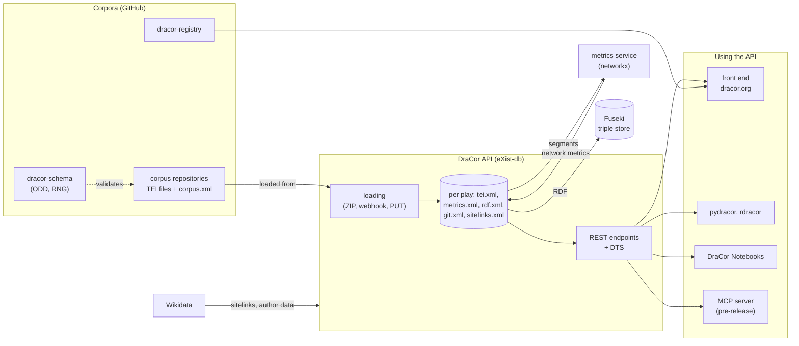

:::{note} Draft
:class: editorial
This page describes the DraCor system as of November 2026. It updates the overview in [D7.1 ch. 5](#clsinfra-d71-5) and its system chart (Fig. 08).
:::

DraCor implements the concept of **Programmable Corpora** ([D7.1](#clsinfra-d71-index)): its drama corpora can not only be read on a website but also be queried, analysed and reused through an API. The system consists of separate components, each in its own repository on GitHub ([dracor-org](https://github.com/dracor-org)) with its own releases. This page shows how they fit together; the pages listed in the table below describe each component.

(docs-overview-chart)=
## The system at a glance

1. **Corpora.** Each corpus is a Git repository with one TEI file per play and a corpus description (`corpus.xml`). The TEI follows the DraCor encoding guidelines ([dracor-schema](https://github.com/dracor-org/dracor-schema): ODD and schemas); a GitHub Action ([dracor-validate-action](https://github.com/dracor-org/dracor-validate-action)) checks the changed files on every push and pull request. The [registry](https://github.com/dracor-org/dracor-registry) lists all corpora, published and planned.
2. **API.** The [DraCor API](#dracor-api) is an eXist-db application. It loads a corpus from its repository (as a ZIP archive of a given commit, or, where a webhook is set up, file by file after each push), stores each play together with the data derived from it, and offers everything through its REST endpoints and DTS ([API › Loading data](#dracor-api-loading)).
3. **Services.** When a play is stored, the API asks the [metrics service](#dracor-metrics) for the network metrics, Wikidata for the number of Wikipedia articles, and sends the play's RDF to the triple store (Fuseki), which offers a SPARQL endpoint.
4. **Using the API.** The [front end](#dracor-frontend) on dracor.org is one client of the API among others: the libraries [pydracor](https://github.com/dracor-org/pydracor) and [rdracor](https://github.com/dracor-org/rdracor), the [DraCor Notebooks](https://github.com/dracor-org/dracor-notebooks), an [MCP server](https://github.com/dracor-org/dracor-mcp) that lets AI assistants use the API (pre-release), and external tools linked from the front end (Voyant, the CLARIN Switchboard, Gephi Lite; [D7.4 §3.6](#clsinfra-d74-3-6)).

(docs-overview-components)=
## Components

| Component | Repository | Role | Release (Nov. 2026) | Documented in |
|---|---|---|---|---|
| corpora | one per corpus, e.g. [gerdracor](https://github.com/dracor-org/gerdracor) | TEI files and corpus description | (Git commits; some corpora have releases with DOIs) | [Corpora](#docs-corpora) |
| encoding guidelines | [dracor-schema](https://github.com/dracor-org/dracor-schema) | ODD, schemas | 1.6.0 (1.7.0-alpha.1) | [ODD](https://dracor.org/doc/odd) |
| corpus registry | [dracor-registry](https://github.com/dracor-org/dracor-registry) | list of all corpora | 1.16.0 | [Corpora](#docs-corpora-registry) |
| API | [dracor-api](https://github.com/dracor-org/dracor-api) | loading, storage, endpoints, DTS | 1.4.1 (1.5.0-rc.1) | [API](#dracor-api) |
| metrics service | [dracor-metrics](https://github.com/dracor-org/dracor-metrics) | network metrics | 1.6.0 | [Metrics service](#dracor-metrics) |
| triple store | [dracor-fuseki](https://github.com/dracor-org/dracor-fuseki) | RDF, SPARQL | 1.1.3 (2.0.0-rc.1) | to be written ([D7.1 §5.5](#clsinfra-d71-5-5)) |
| front end | [dracor-frontend](https://github.com/dracor-org/dracor-frontend) | the website | 2.7.2 (3.0.0-rc.1) | [Frontend](#dracor-frontend) |
| component library | [dracor-react](https://github.com/dracor-org/dracor-react) | React components of the website and the DraCor Spin-offs | 1.11.0 | [Frontend](#dracor-frontend), [Building DraCor Spin-offs](#spinoffs) |
| website texts | [dracor-docs](https://github.com/dracor-org/dracor-docs) | documentation pages and menu of dracor.org | (no releases) | [Frontend](#dracor-frontend-menu) |
| API libraries | [pydracor](https://github.com/dracor-org/pydracor), [rdracor](https://github.com/dracor-org/rdracor) | access to the API from Python and R | pydracor 3.0.2; rdracor 1.1.0 (CRAN) | [API libraries](#docs-libraries) |
| MCP server | [dracor-mcp](https://github.com/dracor-org/dracor-mcp) | access for AI assistants | 1.0.0-beta.2 | to be written |

Versions in brackets are the newest pre-releases. The API, the metrics service, Fuseki and the front end are published as Docker images; the compose file in the API repository starts all four in matching versions (for 1.5.0-rc.1: API 1.5.0-rc.1, Fuseki 2.0.0-rc.1, metrics 1.6.0, front end 3.0.0-rc.1; [API › Architecture](#dracor-api-architecture)).

(docs-overview-deployments)=
## Where DraCor runs

| Server | Purpose | API (checked 22 Nov. 2026) | Front end |
|---|---|---|---|
| [dracor.org](https://dracor.org) | production; the published corpora (24), updated by loading them explicitly (no webhook) | 1.4.1 | 2.x |
| [staging.dracor.org](https://staging.dracor.org) | the next release: the software is updated on every change to `main`, the corpora on every push to their repositories (webhook); also draft corpora (31 in all) | development state after 1.5.0-rc.1 | 3.0.0-rc.1 |
| [dev.dracor.org](https://dev.dracor.org) | development, deployed by hand | development state after 1.5.0-rc.1 | |

Which version a server runs is reported by `/api/v1/info` ([API › Versions](#dracor-api-versions)). Anyone can run their own DraCor: locally with the compose file of the API, or in the cloud, e.g. with the [guide for the EOSC EU Node](https://github.com/dracor-org/dracor-eosc-eu-node-deploy).

(docs-overview-changes)=
## What has changed since D7.1

The architecture of D7.1's chart still holds: corpora in Git repositories, an XML database with the API at the centre, the metrics service and the triple store attached, and the front end as a client. Since then:

- the API has a **versioned interface** (`/api/v1`, since 1.0.0; the legacy API v0 will be shut down) and implements **DTS 1.0** ([API](#dracor-api));
- every play is stored with the **Git commit** it was loaded from, so that data can be traced to a corpus version ([D7.3](#clsinfra-d73-index));
- corpora can be **updated automatically** on every push (GitHub webhook); this is set up for staging and dev, while production is updated by loading a corpus explicitly;
- the values in the API responses carry **feature names** in the API specification ([API › Specification](#dracor-api-docs), [D7.4 §3.3](#clsinfra-d74-3-3));
- the **front end** is built on a shared component library, which the DraCor Spin-offs use as well ([Frontend](#dracor-frontend), [Building DraCor Spin-offs](#spinoffs));
- **new clients:** the MCP server for AI assistants, the DraCor Notebooks, the API libraries in new versions;
- all server components are published as **Docker images** and can be deployed as a whole.

(docs-overview-reports)=
## From D7.1 ch. 5 to the System Documentation

| D7.1 | Topic | Now |
|---|---|---|
| ch. 5 intro, Fig. 08 | the system | this page |
| §5.1 | corpora | [Corpora](#docs-corpora) (encoding: [ODD](https://dracor.org/doc/odd)) |
| §5.2.1 | GitHub repositories | [Corpora](#docs-corpora) |
| §5.2.2 | eXist-db | [API › Architecture](#dracor-api-architecture), [Loading data](#dracor-api-loading) (in part) |
| §5.3 | API | [API](#dracor-api) |
| §5.3.4 | API wrappers | [API libraries](#docs-libraries) |
| §5.4 | metrics service | [Metrics service](#dracor-metrics) |
| §5.5 | SPARQL endpoint | to be written |
| §5.6 | front end | [Frontend](#dracor-frontend); the speech-distribution charts are explained in the [D7.1 excursus](#clsinfra-d71-excursus) |
